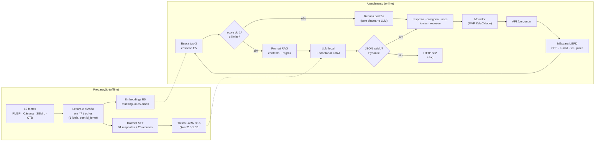

# Relatório técnico — Zela, a IA local da ZelaCidade

**Global Solution 2026.2 · CitizenTech · Generative AI for Engineering** · Prof. Francisco Elanio Bezerra

> Todos os números vêm dos arquivos gerados ao rodar os notebooks 01–06 (`avaliacao/limiar.json`,
> `avaliacao/placar.md`, `avaliacao/resultados/`).

---

## 01 · Integrantes

| Nome completo | RM |
|---|---|
| Bruno Venturi Lopes Vieira | 99431 |
| Guilherme Alves de Lima | 550433 |
| Leonardo de Oliveira Ruiz | 98901 |

## 02 · Ficha Técnica — o que a IA resolve

**Problema (segurança e mobilidade):** quem encontra um buraco, uma calçada quebrada, um poste apagado ou um bueiro
entupido raramente sabe (1) se aquilo é perigoso, (2) de quem é a responsabilidade — Prefeitura, concessionária ou
o dono do imóvel — e (3) por qual canal oficial pedir o conserto. A Prefeitura de SP tem mais de 700 serviços no
SP156, o que torna difícil achar o certo. Uma resposta errada (telefone desativado, prazo inventado, responsável
errado) faz o morador desistir ou se colocar em risco.

**O que a Zela faz:** recebe a pergunta em linguagem natural e devolve, em JSON, uma orientação curta, a categoria
do problema, o nível de risco, **os trechos oficiais que sustentam a resposta** e se ela **recusou** por falta de
base. A resposta aparece no MVP logo depois do registro da ocorrência (e a categoria pode vir do modelo de visão
computacional da equipe).

| Campo | Conteúdo |
|---|---|
| Nome do produto | ZelaCidade — componente de IA "Zela" |
| Cidadão e território | Moradores de São Paulo; piloto na Zona Norte (Santana/Tucuruvi) |
| Problema, em uma frase | O morador não sabe se o problema é perigoso, de quem é a responsabilidade e onde pedir o conserto |
| Proposta de valor | Orientação imediata, simples e verificável, com fonte oficial citada |
| Arquitetura | Base (47 trechos) → busca E5 → limiar → Qwen2.5-1.5B + LoRA → validação JSON → API FastAPI |
| Fontes de dados | 18 fontes oficiais públicas + 1 documento interno (ver seção 04) |
| Modelos de IA | Qwen2.5-1.5B-Instruct, adaptador LoRA próprio (r=16), multilingual-e5-small |
| URL do MVP e repositório | MVP: https://app-zelacidade-gs-99431.azurewebsites.net/painel · Repositório: https://github.com/GuiAlves2005/zelacidade-genai |
| Indicadores de impacto | acurácia com fonte, taxa de alucinação, recusa correta, moradores orientados, conversão para protocolo SP156 |
| ODS | 11 (11.2 e 11.7), 9, 10 |

## 03 · Diagrama do pipeline de IA e dos documentos

**Três configurações comparadas**

| Config | Busca | Contexto no prompt | Modelo |
|---|---|---|---|
| A | — | não | Qwen2.5-1.5B-Instruct |
| B | E5 top-3 + limiar | sim | Qwen2.5-1.5B-Instruct |
| C | E5 top-3 + limiar | sim | Qwen2.5-1.5B-Instruct **+ LoRA** |

## 04 · Base de conhecimento

Cada fonte foi lida e dividida em **trechos autocontidos** (uma ideia por trecho, 1–4 frases), reescritos em
linguagem simples e ligados ao `id_fonte`. Atos oficiais são de domínio público (Lei 9.610/98, art. 8º, IV);
páginas institucionais são usadas para fins educacionais com citação. Data de acesso de todas: 11/11/2026.

| Fonte | Título | Órgão | Formato | Licença | Nº trechos |
|---|---|---|---|---|---|
| F01 | Tapa Buraco (Zeladoria Urbana) | Subprefeitura Sapopemba / PMSP | HTML | Institucional público – uso educacional c/ citação | 6 |
| F02 | Operação Tapa-Buraco no Ipiranga | Subprefeitura Ipiranga / PMSP | HTML | Institucional público – uso educacional c/ citação | 3 |
| F03 | Decreto 59.671/2020 (padronização das calçadas) | Prefeitura de SP | PDF | Domínio público (ato oficial) | 7 |
| F04 | Iluminação pública – perguntas frequentes | SP Regula / PMSP | HTML | Institucional público – uso educacional c/ citação | 5 |
| F05 | Manutenção de iluminação apagada/acesa | SP Regula / PMSP | HTML | Institucional público – uso educacional c/ citação | 1 |
| F06 | Iluminação pública – como solicitar | SP Regula / PMSP | HTML | Institucional público – uso educacional c/ citação | 1 |
| F07 | Poda e remoção de árvores | Subprefeitura Butantã / PMSP | HTML | Institucional público – uso educacional c/ citação | 3 |
| F08 | Limpeza de bocas de lobo, galerias e ramais | Subprefeitura Santana/Tucuruvi / PMSP | HTML | Institucional público – uso educacional c/ citação | 1 |
| F09 | Rua e bairro – lista de serviços SP156 | SMSUB / PMSP | HTML | Institucional público – uso educacional c/ citação | 2 |
| F10 | Calçadas – especificações técnicas | SMSUB / PMSP | HTML | Institucional público – uso educacional c/ citação | 2 |
| F11 | Orientações de segurança em chuvas | SEMIL – Governo de SP | HTML | Institucional público – uso educacional c/ citação | 4 |
| F12 | SP156 utiliza IA (Solicitação Inteligente) | SMIT / PMSP | HTML | Institucional público – uso educacional c/ citação | 2 |
| F13 | CET agora é 156 | PMSP | HTML | Institucional público – uso educacional c/ citação | 1 |
| F14 | SP156 na palma da sua mão | Subprefeitura Lapa / PMSP | HTML | Institucional público – uso educacional c/ citação | 1 |
| F15 | Lei 15.442/2011 | Câmara Municipal de SP | PDF | Domínio público (ato oficial) | 1 |
| F16 | Calçadas: responsabilidade (notícia) | SMSUB / PMSP | HTML | Institucional público – uso educacional c/ citação | 1 |
| F17 | Ampliação – novo ponto de iluminação | PMSP | HTML | Institucional público – uso educacional c/ citação | 1 |
| F18 | CTB (Lei 9.503/1997) art. 94 | Presidência da República | HTML | Domínio público (ato oficial) | 2 |
| F19 | Proposta ZelaCidade | Equipe | PDF | Autoria própria | 3 |
| | **Total** | | | | **47** |

URLs completas em [`base/fontes.csv`](base/fontes.csv) e [`base/tabela_base.md`](base/tabela_base.md).

**Conjunto de teste** (`avaliacao/perguntas_teste.jsonl`): 50 perguntas escritas pela equipe com gabarito —
40 respondíveis (com trechos relevantes e pontos-chave obrigatórios) e **10 "não consta"** (ex.: valor da multa
de calçada, indenização por pneu furado, telefone de uma subprefeitura que não está na base). As perguntas de treino
do LoRA são diferentes das de teste: 0 perguntas idênticas e similaridade TF-IDF máxima de 0,40 entre os conjuntos
(`avaliacao/resultados/vazamento.json`).

## 05 · Performance

### 5.1 Busca (recall@k e limiar)

| Busca | recall@1 | recall@3 | Limiar | TPR treino | TNR treino | Respondíveis que passam (teste) | "Não consta" barradas (teste) |
|---|---|---|---|---|---|---|---|
| TF-IDF (linha de base) | 0,725 | 0,800 | 0,129 | 0,93 | 0,64 | 85% | 40% |
| E5 multilíngue | 0,825 | 1,000 | 0,851 | 0,95 | 0,88 | 100% | 70% |

Fonte: `avaliacao/limiar.json` (40 respondíveis e 10 "não consta" do teste).

**Justificativa do limiar:** escolhido no conjunto de treino (94 perguntas com resposta + 25 fora do escopo) pelo
valor que maximiza a acurácia balanceada (média entre "respondíveis que passam" e "fora do escopo barradas"), sem
olhar o teste. Gráficos: `avaliacao/resultados/limiar_e5.png`. Ele barra perguntas claramente fora do tema
(CNH, previsão do tempo) sem custo de LLM; perguntas do mesmo tema sem resposta na base (valor de multa) passam
do limiar e precisam ser recusadas pelo modelo — por isso a recusa tem duas camadas.

### 5.2 Placar das três configurações (50 perguntas)

Fonte: `avaliacao/placar.md` — 50 perguntas; busca e5, top-k=3, limiar 0,8511; latência medida na avaliação em lote,
na GPU. Gráfico: `avaliacao/resultados/placar.png`.

| Config | Acurácia (respondíveis) | Recusa correta ("não consta") | Recusa indevida | Alucinação | JSON válido | Citação correta | Latência média |
|---|---|---|---|---|---|---|---|
| A — sem contexto | 10,0% | 0,0% | 0,0% | 64,0% | 72,0% | 5,0% | 3,15 s |
| B — RAG simples | 20,0% | 70,0% | 0,0% | 8,0% | 38,0% | 25,0% | 3,39 s |
| C — RAG + LoRA | 87,5% | 80,0% | 0,0% | 14,0% | 100,0% | 92,5% | 6,33 s |

Citação fantasma (citou trecho que não recebeu): A 32,0% · B 0,0% · C 0,0%.

**Definições:** *acerto* = não recusou e a resposta contém todos os pontos-chave do gabarito · *alucinação* =
respondeu uma pergunta "não consta", **ou** citou trecho que não recebeu, **ou** respondeu errado uma pergunta
respondível · *citação correta* = citou ao menos um trecho do gabarito.

**Interpretação**

- **A → B (efeito do contexto):** o RAG eliminou as citações fantasma (32% → 0%) e o limiar passou a barrar 7 das 10
  "não consta" sem chamar o modelo (recusa correta 0% → 70%). Mas a acurácia só foi de 10% para 20% e o JSON válido
  **caiu** de 72% para 38%: com o prompt longo (regras + 3 trechos), o Qwen 1,5B sem ajuste abandona o formato. Das 31
  saídas inválidas, 27 não têm JSON (26 começam com "Recusou: true" e seguem em texto livre, muitas vezes com conteúdo
  correto) e 4 são JSON sem o campo `recusou`. **A alucinação menor da B (8%, contra 14% da C) não significa que ela
  seja mais confiável: 62% das saídas da B nem foram JSON válido, e pela definição usada JSON inválido conta como
  falha, mas não como alucinação.** Na API, essas perguntas virariam HTTP 502. As 7 recusas corretas da B vieram todas
  do limiar; o modelo não recusou nenhuma das 3 "não consta" que passaram dele. Essa é a principal limitação do RAG
  simples com um modelo de 1,5B.
- **B → C (efeito do LoRA):** formato (JSON válido 38% → 100%), citação (25% → 92,5%) e acurácia (20% → 87,5%).
  Recusa correta 70% → 80%: 7 pelo limiar + 1 pelo modelo (Q42, valor da multa). As 7 alucinações da C são 5
  respondíveis sem os pontos-chave e 2 "não consta" respondidas (Q41, Q48) — ver seção 06. Nenhuma recusa indevida
  nem citação fantasma. Toda resposta da C é a cópia literal de um trecho (o alvo do SFT era o texto do trecho): fiel à
  fonte, mas às vezes copia o trecho errado.
- **Latência:** na avaliação em lote, a C levou 6,33 s em média contra 3,39 s da B — gera sempre o JSON completo (a B
  costumava gerar texto curto fora do formato) e o adaptador LoRA é calculado à parte a cada token. Na API (config C,
  mediana das chamadas 2 e 3, descartando a 1ª como aquecimento):

| Pergunta | GPU RTX 5060 Ti (bf16) | CPU Ryzen 5 5600X (fp32) | Resultado |
|---|---|---|---|
| (a) "Tem um buraco enorme na minha rua, o que eu faço?" | 6,49 s | 33,60 s | respondeu, citando T006 |
| (b) "Qual o valor da multa por calçada irregular?" | 4,42 s | 25,92 s | recusou (modelo) |
| (c) "Como faço para renovar minha CNH?" | 0,008 s | 0,014 s | recusou (limiar, sem chamar o LLM) |

  As respostas foram idênticas na GPU e na CPU. Na CPU, a RAM livre ficou em ~1 GB, sem paginação contínua (variação
  < 1% entre as chamadas). JSONs completos em `avaliacao/resultados/exemplos_api.json`.
- **Configuração escolhida para a API: C.** É a única com 100% de JSON válido (requisito: a API devolve 502 quando o
  formato falha), com a maior acurácia (87,5%), citação correta (92,5%) e recusa correta (80%), sem recusa indevida
  nem citação fantasma. O custo é ~2× a latência da B: ~6 s na GPU é aceitável para orientar após o registro da
  ocorrência; na CPU (26–34 s) fica lenta, então o servidor do MVP deve ter GPU.

### 5.3 Treino do LoRA

119 exemplos SFT (108 treino / 11 validação), r=16, 3 épocas, 18,5 M parâmetros treináveis (1,18%), 334 s na RTX 5060
Ti. Loss de treino 0,225 → 0,0065; loss de validação 0,0298 → 0,0217 → 0,0174 (épocas 1, 2 e 3), sem sinal de
sobreajuste. Curva: `avaliacao/resultados/curva_loss_lora.png` (notebook 04).

### 5.4 Demonstração de alucinações (mesma pergunta nas três configurações)

Textos copiados sem edição de `avaliacao/resultados/execucoes_A.jsonl`, `execucoes_B.jsonl` e `execucoes_C.jsonl`
(campo `resposta` quando o JSON é válido; saída bruta completa quando não é). Contexto recuperado nas configs B e C
entre colchetes, com o score do E5.

**Q26 — "Três postes da minha rua estão apagados à noite. Qual telefone gratuito eu uso?"**
Gabarito: 0800 779 0156 (SP Regula Iluminação Pública) ou a Central SP156 — trecho T027.

| Config | Resposta | Avaliação |
|---|---|---|
| A (sem contexto) | "Para relatar o problema de falta de energia elétrica nos postes da sua rua, utilize o número gratuito 193. Este serviço é fornecido pela Agência Nacional de Telecomunicações (ANATEL) para reportar falhas de serviços de telecomunicação." — categoria `canais`, fontes `["T002"]` | **Alucinação perigosa:** 193 é o Corpo de Bombeiros, não um canal de iluminação, e a ANATEL não tem relação com o serviço. **Citação fantasma:** citou T002 sem ter recebido contexto. |
| B (RAG) [T029 0,8765 · T039 0,8744 · T027 0,8713] | "Para os três postes apagados à noite na sua rua, você pode usar o telefone gratuito SP156 para reportar a falha. Ligue para 0800 779 0156 e informe que está havendo problemas com os postes da sua rua." — categoria `obstaculo_sinalizacao`, fontes `["T029"]` | Número certo (acerto). Mas citou T029 — que também traz o 0800, porém o gabarito marca só T027, então a citação conta como incorreta — e a categoria deveria ser `iluminacao`. |
| C (RAG + LoRA) | "Para lâmpadas apagadas, queimadas, piscando ou acesas durante o dia, o morador deve acionar a Central SP156 ou a SP Regula Iluminação Pública pelo 0800 779 0156, ligação gratuita com atendimento 24 horas. Uma equipe técnica vai ao local avaliar o equipamento e, constatado o problema, executa o reparo." — categoria `iluminacao`, fontes `["T027"]` | Correta: cópia literal do T027, citação e categoria certas. |

**Q09 — "Qual é o número de WhatsApp da prefeitura de SP para pedir tapa-buraco?"**
Gabarito: (11) 3230-5156 — trecho T007.

| Config | Resposta | Avaliação |
|---|---|---|
| A (sem contexto) | "O número oficial do WhatsApp da Secretaria Municipal de Obras da Prefeitura de São Paulo para solicitar serviços de tapa-buracos é (+55) 11 3289-7000." — fontes `["T001"]` | **Alucinação:** número e órgão inventados. **Citação fantasma:** citou T001 sem ter recebido contexto. |
| B (RAG) [T007 0,9253 · T002 0,9053 · T001 0,8696] | "Para solicitar o tapa-buraco através do WhatsApp da Prefeitura, use o número (11) 3230-5156." — fontes `["T001"]` | Número certo (acerto), mas citação errada: o número está no T007, e o T001 (definição do tapa-buraco) não o contém. |
| C (RAG + LoRA) | "No aplicativo SP156, o pedido de tapa-buraco fica em 'Rua e bairro', depois 'Reparos em asfaltos' e por fim 'Tapa-buraco'. A solicitação também pode ser feita pelo Portal SP156 ou pelo WhatsApp da Prefeitura, no número (11) 3230-5156." — fontes `["T007"]` | Correta: cópia literal do T007, citação certa. |

**Q42 — "Qual o valor em reais da multa por calçada fora do padrão?"** ("não consta": a base cita a multa da Lei
15.442/2011, mas não o valor).

| Config | Resposta | Avaliação |
|---|---|---|
| A (sem contexto) | Saída bruta completa: "Recusou" | **Saída inválida** (sem JSON): a API devolveria HTTP 502. |
| B (RAG) [T021 0,8693 · T014 0,8574 · T022 0,8569] | Saída bruta completa: "recusou:true fontes:["T021","T014"] categoria:"buraco_via" risco:"baixo"  A Lei Municipal 15.442/2011 estabelece multas para violações à faixa livre de 1,20 m nas calçadas. No entanto, a quantidade específica de reais da multa não está contida nesta base de dados. Recomenda-se consultar diretamente o site oficial da Prefeitura de São Paulo ou o site da Secretaria de Segurança Pública para obter mais detalhes sobre as multas relacionadas à calçada." | **Saída inválida** (texto livre com "recusou:true", sem JSON). O conteúdo até reconhece que o valor não está na base, mas cita fontes numa recusa, usa categoria `buraco_via` e indica a Secretaria de Segurança Pública, que não está em nenhum trecho. |
| C (RAG + LoRA) | "Não consta na base de conhecimento da ZelaCidade. Para esse assunto, consulte os canais oficiais da Prefeitura (SP156)." — categoria `fora_do_escopo`, risco `nao_se_aplica`, fontes `[]`, `recusou: true` | **Recusa correta** no formato do esquema, feita pelo modelo (a pergunta passou do limiar). |

## 06 · Cinco erros reais, causa e correção

Tirados de `notebooks/06_analise_erros.ipynb`, `avaliacao/resultados/execucoes_*.jsonl` e
`avaliacao/resultados/exemplos_api.json`.

| # | Config / pergunta | O que aconteceu | Causa | Correção proposta |
|---|---|---|---|---|
| 1 | C (API) — "Tem um buraco enorme na minha rua, o que eu faço?" *(observada na API; não está no conjunto de teste)* | Respondeu que o tapa-buraco não é feito na chuva e que recapeamento é outro pedido (T006); não disse onde pedir o conserto. A equivalente no teste (Q01) também falhou: a C copiou o T001 (definição do tapa-buraco), sem o canal. | **Busca:** top-3 do E5 = T006 (0,8666), T001 (0,8653), T007 (0,8641), separados por só 0,0025; T002 (canais) e T009 (urgência) ficaram de fora. | Re-ranking com cross-encoder ou busca híbrida E5 + TF-IDF; top-k maior quando os scores empatam. |
| 2 | B — Q03 "Uma obra da Sabesp deixou uma vala aberta na minha rua. A prefeitura vai tapar?" | Conteúdo certo (concessionária responde, citou T004), mas saiu como "Recusou: true / Fontes: [T004] / Risco: Alto…", sem JSON. É o padrão de 26 das 31 saídas inválidas da B. | **Formato:** o modelo de 1,5B sem ajuste não segue o esquema com prompt longo; imita a lista de campos e a regra de recusa do prompt. | LoRA (C: 100% JSON válido); sem treino: decodificação restrita por esquema JSON (gramática). |
| 3 | A — Q09 "Qual é o número de WhatsApp da prefeitura de SP para pedir tapa-buraco?" | Inventou "(+55) 11 3289-7000" da "Secretaria Municipal de Obras" e citou T001 sem ter recebido trecho nenhum. Certo: (11) 3230-5156 (T007). | **Alucinação sem contexto:** o modelo preenche a lacuna com um número plausível. | Não servir a config A (B e C deram o número certo); validar telefones da resposta contra os trechos citados. |
| 4 | C — Q41 "Furei o pneu num buraco da rua. Como peço indenização da prefeitura?" ("não consta") | Respondeu com o texto do T004 (buraco aberto por concessionária). | **Recusa:** pergunta do mesmo tema passa no limiar (0,8582 > 0,8511); o SFT teve 25 recusas contra 94 respostas, a maioria fora do tema, e o LoRA aprendeu a copiar o trecho mais próximo. | Mais negativos difíceis no SFT: perguntas do tema sem resposta no contexto (indenização, prazos, valores). |
| 5 | C — Q27 "A luz do poste em frente de casa fica acesa durante a tarde toda. Devo reportar?" | Copiou o T029 (rua sem luz × casa sem energia), embora o T028 — que responde exatamente ("acesa nos períodos da manhã e da tarde") — fosse o 1º do contexto. | **Escolha do trecho / cópia literal:** o alvo do SFT era o texto inteiro de um trecho; o LoRA aprendeu a copiar um trecho em vez de responder à pergunta, e às vezes escolhe o errado. | Alvos do SFT redigidos como resposta à pergunta, com o trecho certo em posições variadas do contexto. |

## 07 · Conclusão técnica

Nas 50 perguntas de teste, o RAG com E5 recuperou um trecho relevante entre os 3 primeiros em todas as respondíveis
(recall@3 = 1,0 segundo o gabarito), mas sozinho (B) não bastou: eliminou as citações fantasma (32% → 0%) e barrou 70%
das "não consta" pelo limiar, porém a acurácia ficou em 20% porque 62% das saídas nem foram JSON válido. O LoRA (C)
levou o JSON válido a 100%, a acurácia a 87,5% (+77,5 pontos sobre A e +67,5 sobre B), a citação correta a 92,5% e a
recusa correta a 80%, com 14% de alucinação contra 64% da A.

**Limites:** base pequena (47 trechos de 19 fontes); base e conjunto de teste escritos pela mesma equipe, o que pode
favorecer o vocabulário da busca (apesar de 0 perguntas idênticas ao treino e similaridade máxima de 0,40); gabarito
por pontos-chave verificado por substring, o que favorece a C, que copia os trechos; alguns trechos marcados como
relevantes no gabarito não bastam sozinhos para responder (ex.: Q01 lista T001, que define o tapa-buraco mas não diz
onde pedir), então o recall@3 conta acerto mesmo quando o trecho decisivo ficou de fora; teste pequeno (uma pergunta
vale 2,5 pontos nas respondíveis e 10 nas "não consta"); modelo de 1,5B que não segue o formato sem ajuste e, mesmo
com LoRA, ainda respondeu 2 das 10 "não consta"; latência em CPU (26–34 s) inviável para servir sem GPU.

**Próximos passos:** `merge_and_unload()` do LoRA (fundir o adaptador no modelo base, sem custo extra por token) para
reduzir a latência da C; re-ranking ou busca híbrida; negativos difíceis no SFT e alvos redigidos em vez de cópia do
trecho; ampliar a base com mais serviços do SP156; avaliação com moradores do piloto (Santana/Tucuruvi) e revisão
humana do gabarito.

**Links**
- Repositório: https://github.com/GuiAlves2005/zelacidade-genai
- MVP: https://app-zelacidade-gs-99431.azurewebsites.net/painel
